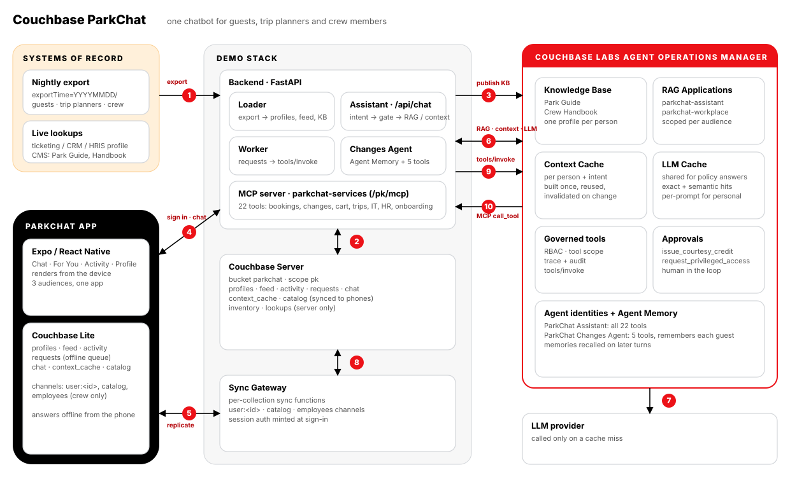
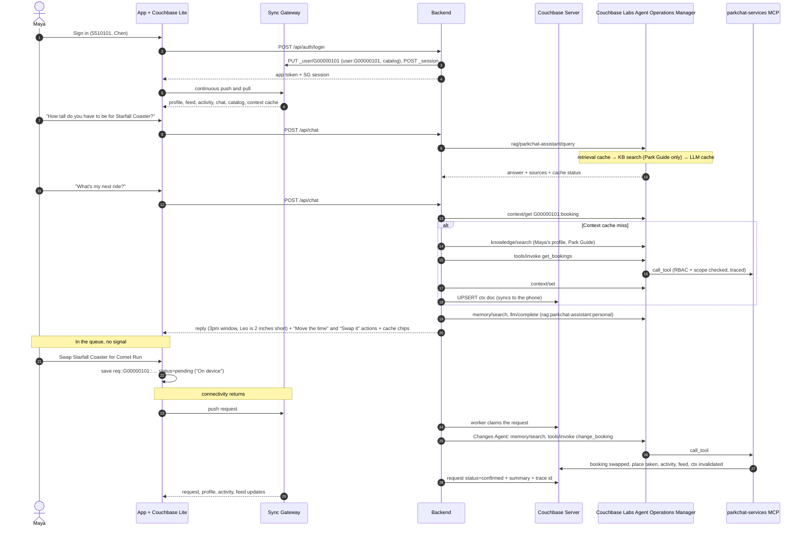
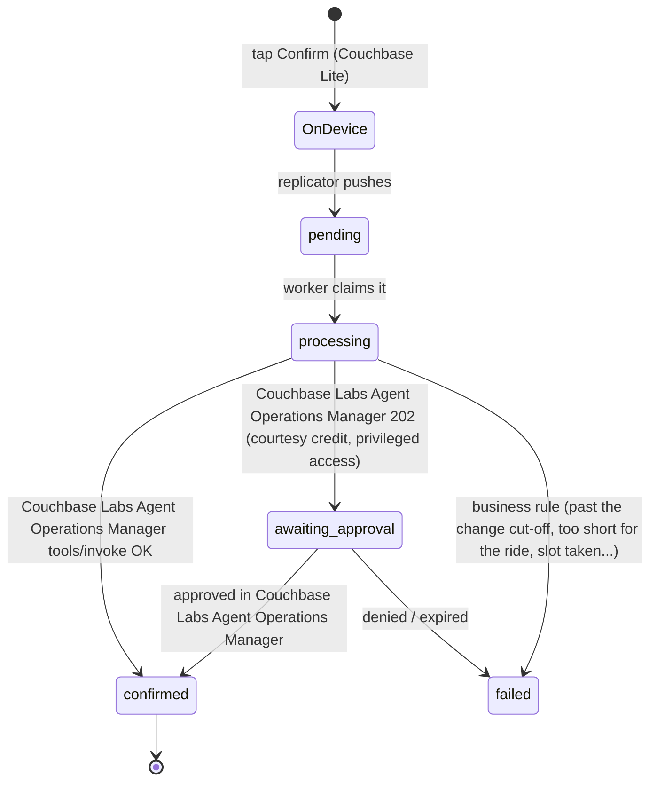

# Couchbase ParkChat · Theme Park Mobile AI Personalization Demo

One chatbot for the whole park. **ParkChat** is a mobile assistant for the fictional theme park **Lumina Park** that serves three audiences - guests in the park, people planning a group trip, and the crew who run it - from one app, one knowledge plane and one governed tool set:

| Area | Who asks | What ParkChat does |
|---|---|---|
| **Guest Support & FAQs** | Guests, trip planners | Park hours, tickets, height requirements, wait times, refund policy, parking, accessibility, lost and found |
| **Plans & Bookings** | Guests | Today's plan, express passes, dining and show times, moving a time, swaps and refunds, a courtesy credit when a ride breaks down, abandoned-cart recovery |
| **Trips & Groups** | Trip planners | Guides experience discovery, captures the trip details, qualifies the lead, sizes a group package, books a planning session |
| **Crew IT & HR** | Crew members | Next shift and shift swaps, help desk tickets for handhelds, password resets and access requests, benefits, time off, onboarding paperwork |

It is the theme park edition of the [OneChat demo](https://github.com/Couchbase-Field-Engineering/couchbase-onechat-mobile-ai-personalization-demo): the same architecture and mechanics, with the retail domain replaced by the things guests and crew actually ask a park app. A park is a good place to show the stack, because the two hard parts are both true there: answers depend on who is asking (a guest's party includes a seven-year-old who is 46 inches tall; a ride operator must never see the cash office console without approval), and the signal is worst exactly where people have time to ask - in a queue.

Under it sits the Couchbase stack: **Couchbase Lite** on the phone, **Sync Gateway**, **Couchbase Server**, and the **Couchbase Labs Agent Operations Manager** for the AI plane:

* answers are grounded in Couchbase Labs Agent Operations Manager's **Knowledge Base** (a Park Guide for everyone, a Crew Handbook for crew only, and one profile document per person)
* ParkChat is registered as two Couchbase Labs Agent Operations Manager **RAG Applications** (`parkchat-assistant`, `parkchat-workplace`), so queries, cache hits and savings show per audience on Couchbase Labs Agent Operations Manager's *RAG Applications* page
* the context built for each personal answer is cached in Couchbase Labs Agent Operations Manager's **Context Cache** and in Couchbase, which syncs it to the phone for offline answers
* LLM calls go through Couchbase Labs Agent Operations Manager's **LLM Caching** gateway: a height-requirement question one guest paid for is free for the next ten thousand
* every action (moving a time, swaps and refunds, checkout, planning sessions, IT tickets, time off, benefits) runs as an RBAC-checked, traced and audited Couchbase Labs Agent Operations Manager **tool call**, with human approval for courtesy credits and privileged access
* a second agent, the **ParkChat Changes Agent**, handles swaps, refunds and credits with a narrower tool scope and **Agent Memory**

---

## How the demo opens

`https://<host>:5160/story` is an eight-chapter story for the room before the live app, about what it costs to run one chatbot for a whole park and how the Couchbase stack cuts that cost.

1. **Title.** One chatbot for guests, trip planners and crew members.
2. **Four jobs.** The four use-case areas, usually four separate bots.
3. **What breaks.** Repeat questions, context rebuilt every turn, unscoped retrieval (a crew handbook answer leaking to a guest), and nothing at all offline.
4. **How it usually gets built.** Every box between the question and the answer is a bill. Press **Transform the stack**, or **T**.
5. **Five questions, two bills.** The same questions walked through a Couchbase Labs Agent Operations Manager-governed ParkChat and a plain chatbot, with a running LLM spend on each phone.
6. **Build the context once.** Nightly export to Couchbase to the Couchbase Labs Agent Operations Manager Knowledge Base, RAG apps and caches, and on to the phone, with live numbers from this demo.
7. **Question by question.** Cost with a model call every time versus through the caches.
8. **See it run.** Links to the app and Couchbase Labs Agent Operations Manager, a short script, the park workload and the reset button.

The page is served by the `web` container (`web/story.html`); its live numbers come from `/api/status`.

## What the demo shows

| Concept | Where you see it |
|---|---|
| **One app, three audiences** | Sign in as a guest, a trip planner or a crew member: the chat starters, *For You* cards, activity list and quick actions all change. The phone only ever holds that person's documents. |
| **Audience-scoped knowledge** | The Crew Handbook lives in its own RAG application and its own Sync Gateway channel (`employees`). A guest who asks about PTO or the CrewPass password gets a polite refusal with nothing retrieved (`restricted: true`). |
| **Couchbase Lite: offline and online** | Every screen renders from the on-device database. *Profile → Offline mode* pauses replication: actions queue as `requests` documents ("On device") and questions already answered are answered again from the phone. |
| **Couchbase Labs Agent Operations Manager RAG Applications** | Shared questions ("How tall do you have to be for Starfall Coaster?") go to `POST /v1/agent/rag/<app>/query`: retrieval cache, Knowledge Base search scoped to one document, LLM cache. |
| **Context Caching** | Personal questions ("What's my next ride?") assemble context once per person and intent - profile document (the visit, the party and their heights), policy chunks, governed tool results - and store it in Couchbase Labs Agent Operations Manager's Context Cache and in `context_cache` in Couchbase. Follow-ups reuse it; any change to the person's data invalidates it. |
| **LLM Caching** | Shared answers contain no personal data, so they are shared across everyone (`rag:<app>:playbook`). Personal answers are cached per prompt (`rag:<app>:personal`). The chat shows a chip for each: `Context cache · built / hit`, `LLM cache · miss / exact / semantic`. |
| **Governed actions** | 22 tools on the `parkchat-services` MCP server, called through `POST /v1/tools/invoke` as the *ParkChat Assistant* agent. `issue_courtesy_credit` and `request_privileged_access` sit behind Couchbase Labs Agent Operations Manager's approval tier. |
| **A second agent + Agent Memory** | **Confirm** on a swap or refund creates a request the worker hands to the *ParkChat Changes Agent*: it recalls what the guest told us before, runs the change through its five tools, and remembers the outcome ("Leo isn't tall enough for Starfall Coaster"). |

---

## Architecture



| # | Flow |
|---|---|
| **1** | Every night an `exportTime=YYYYMMDD` JSON Lines partition of guests, trip planners and crew members lands in the export folder. The loader picks up the newest one with a `_SUCCESS` marker. |
| **2** | The loader upserts every profile, builds each person's *For You* feed and activity list, and publishes the catalog (and the crew-only handbook document) in Couchbase Server. |
| **3** | The loader replaces the Couchbase Labs Agent Operations Manager **Knowledge Base** documents (Park Guide, Crew Handbook, one profile per person up to `KB_PROFILE_LIMIT`) and re-scopes the two **RAG Applications** to today's documents. |
| **4** | Sign-in: the backend creates the person's Sync Gateway user (channels `user:<id>`, `catalog`, plus `employees` for crew members) and mints a session. |
| **5** | **Couchbase Lite** replicates continuously with Sync Gateway. Every screen renders from the phone; taps become `requests` documents saved locally. |
| **6** | Chat goes to `/api/chat`. Shared questions go to the audience's RAG Application in one call. Personal questions check Couchbase Labs Agent Operations Manager's Context Cache; on a miss the assistant builds context from the Knowledge Base, the system of record and read-only tools, then caches it. |
| **7** | Couchbase Labs Agent Operations Manager calls the LLM provider only on a cache miss. |
| **8** | Sync Gateway carries requests up and results back down. |
| **9** | The worker runs each request through `POST /v1/tools/invoke` (swaps, refunds and credits go to the Changes Agent), so RBAC, tool scope, the approval tier, a trace and an audit entry are applied. |
| **10** | Couchbase Labs Agent Operations Manager calls the `parkchat-services` MCP server, which applies the change in Couchbase; the updated profile, activity and feed sync back to the phone. |

### A guest's workflow, end to end



A courtesy credit or a privileged-access request follows the same path, except Couchbase Labs Agent Operations Manager answers `202 pending_approval`: the request shows **Awaiting approval** on the phone until someone approves it on Couchbase Labs Agent Operations Manager's *Approvals* page.

### Offline-first request lifecycle



---

## Quick start

### 1. Browser preview in about 2 minutes (no Docker, no Couchbase Labs Agent Operations Manager)

The backend can run on an in-memory store, and the app has a browser preview engine that syncs the same documents over REST. Use this to look at the UX; Couchbase Lite needs a device build (step 3).

```bash
python3 datagen/generate_mock_export.py             # 24 MiB export → data/parkchat-export/exportTime=<today>/
cd backend && python3 -m venv .venv && . .venv/bin/activate && pip install -r requirements.txt
uvicorn app.main:app --port 8200                    # STORE_DRIVER=memory by default
# new terminal
cd mobile && npm install && npx expo start --web    # sign in with a demo persona
```

Without Couchbase Labs Agent Operations Manager the assistant writes its answers itself from the same context, so every flow works; the cache chips simply report "not connected".

### 2. Full stack: Couchbase, Sync Gateway and Couchbase Labs Agent Operations Manager

You need Docker Desktop, and the [Couchbase Labs Agent Operations Manager](https://github.com/erikhinderer/couchbase-agent-operations-manager) running on the same machine at `https://localhost:8090` with its admin password set.

```bash
python3 datagen/generate_mock_export.py
cp .env.example .env
./scripts/setup-corporate-ca.sh            # only behind a TLS-inspecting proxy (Zscaler etc.)
docker compose up -d --build               # couchbase, init, sync-gateway, sg-init, backend, web
docker compose logs -f backend             # wait for "Loaded export …"

python3 scripts/register_with_aom.py --admin-password '<Couchbase Labs Agent Operations Manager admin password>'
docker compose up -d --build backend       # picks up AOM_* from .env, publishes the KB, scopes the RAG apps
```

`register_with_aom.py` is idempotent; `--rotate` issues new agent keys. After it runs, Couchbase Labs Agent Operations Manager shows:

* **Agents**: *ParkChat Assistant* (all 22 `parkchat-services::*` tools) and *ParkChat Changes Agent* (5 tools; key written to `.env` as `AOM_CHANGES_AGENT_API_KEY`)
* **Servers / Catalog**: `parkchat-services` (trusted) and its tools
* **Knowledge**: the Park Guide, the Crew Handbook and per-person profile documents
* **Approvals config**: `issue_courtesy_credit` and `request_privileged_access` require a human
* **RAG Applications**: `parkchat-assistant` (Park Guide) and `parkchat-workplace` (Crew Handbook)
* **Context Cache**: entries in `rag:<app>:user-context`, one per person and intent

Configure an LLM provider key in Couchbase Labs Agent Operations Manager to get generated answers. Without one, Couchbase Labs Agent Operations Manager returns a labelled stub, the backend writes the answer from the same retrieved context, and Couchbase Labs Agent Operations Manager still reports the cache status.

| Port | Service |
|---|---|
| `5160` | **The app in a browser** over HTTPS, behind the sign-in page, inside a phone frame (`?frame=0` for full width), and the story at `/story` |
| `8203` | Backend API + MCP server (`/pk/mcp`); `/` lists every link |
| `4990` | Sync Gateway public, which is what phones replicate with: `ws://<host>:4990/parkchat` |
| `127.0.0.1:4991` | Sync Gateway admin |
| `127.0.0.1:18094` | Couchbase Web Console (Administrator / password123) |

**Sign-in and HTTPS.** The browser UI (the app, the story page and everything else the `web` container serves) is on **`https://<host>:5160`** and opens on a sign-in page:

| Username | Password |
|---|---|
| `demo` | `Couchbase123!` |

Change them with `DEMO_USERNAME` / `DEMO_PASSWORD` in `.env` (Compose) or `web.auth.username` / `web.auth.password` (Helm). The container serves a self-signed certificate it generates on first start, so the browser warns once; add the address people use to `TLS_HOSTS` (Compose) so it is in the certificate, or serve a real one by mounting `tls.crt` / `tls.key` at `/etc/nginx/tls` (Helm: `web.tls.secretName`). Plain `http://` on the same port redirects to HTTPS, and `/signout` ends the session. The sign-in covers the browser UI only: the backend API and Sync Gateway ports are unchanged.

The ports are chosen so this stack runs alongside Couchbase Labs Agent Operations Manager and the Royal Caribbean (8081 / 8200 / 4984), Princess (8082 / 8201 / 4986) and OneChat (5150 / 8202 / 4988) demos.

### 3. The app on a device with Couchbase Lite

Couchbase Lite is a native module, so it needs a **development build**; Expo Go can't load it. `npm install` runs `scripts/fetch-cbl-native.sh`, which fetches the `cbl-reactnative` native submodules that npm skips.

```bash
cd mobile
cp .env.example .env                       # API + Sync Gateway URLs (LAN IP for a physical phone)
npm install
npx expo run:ios -d "iPhone 16 Pro"        # or: npx expo run:android
```

With `EXPO_PUBLIC_DB_ENGINE=auto` the app uses Couchbase Lite whenever the native module is linked. *Profile → Offline & sync* shows the database, the Sync Gateway endpoint, the replicator status and how many documents are waiting to send.

The `web` service serves a prebuilt browser bundle (`web/dist.tgz`). After changing the app, rebuild it with `cd mobile && npm run export:web:docker`, then `docker compose up -d --build web`.

### 4. Kubernetes with Helm (K3s / Rancher)

`deploy/k8s/deploy.sh` deploys Couchbase Labs Agent Operations Manager (**agent-ops**) and this demo (**parkchat-app**) onto a single-node K3s cluster without a container registry:

```bash
AOM_ADMIN_PASSWORD='<12+ characters>' ./deploy/k8s/deploy.sh          # MOTHER=ehind@192.168.111.4 by default
AOM_ADMIN_PASSWORD='<current Couchbase Labs Agent Operations Manager password>' ONLY=parkchat ./deploy/k8s/deploy.sh   # Couchbase Labs Agent Operations Manager is already there
```

It builds the images, copies them over SSH into K3s's containerd, and runs `helm upgrade --install` for [`helm/parkchat-app`](helm/parkchat-app) with [`deploy/k8s/values-mother.yaml`](deploy/k8s/values-mother.yaml), which publishes **5160 / 8203 / 4990**. In the cluster the backend registers itself with Couchbase Labs Agent Operations Manager (`AOM_AUTO_REGISTER=true`): it adds the MCP server, issues both agent identities, turns on the approval tier and publishes the Knowledge Base and RAG applications. Progress is in `/api/status` under `aom.registration`. A CronJob writes a new export partition every morning and the backend picks it up.

`deploy/k8s/deploy-on-mother.sh` does the same from a clone on the node itself; `deploy/k8s/diagnose.sh` prints the state of every piece.

---

## Demo script (about 10 minutes)

Sign in with the account number and last name (the sign-in screen lists them). The demo clock is pinned to the export date, so the story is the same whenever you run it: it is day two of Maya's three-day visit.

1. **Maya Chen** · guest, Lumina Club Gold, in the park with her partner and her son Leo (7, 46 inches) · `5510101` / `Chen`
   * *Chat*: "How tall do you have to be for Starfall Coaster?" → `LLM cache · miss`. "What's my next ride?" → `Context cache · built`: her Starfall Coaster express pass at 3:00pm, a warning that Leo is two inches too short, and **Move the time** and **Swap it for another ride** actions. "When is our dinner reservation?" → `Context cache · hit`.
   * *For You*: the 3pm express pass, tomorrow's dinner at Harbor Lights Grill, the dessert party and photo package still in her cart with a `GLOW10` code, and the last day to change today's booking (Gold members can change on the day itself).
   * *Profile → Offline mode* **on** - she is in a queue with no signal. Swap Starfall Coaster for Comet Run (**On device**; the swap screen greys out rides Leo can't go on), then ask the height question again (**Answered on device**). Switch it **off**: the swap syncs and comes back **Confirmed**. In Couchbase Labs Agent Operations Manager, show the trace for `parkchat-services::change_booking`, run by the Changes Agent, and its memory of why.
   * "Emberwood Rapids broke down while we were in line and nobody helped us" offers a **courtesy credit** on yesterday's booking, which shows **Awaiting approval**. Approve it in Couchbase Labs Agent Operations Manager → *Approvals* and the phone flips to **Confirmed**.
   * "How do I reset my CrewPass password?" is refused: crew knowledge is not in a guest's scope. ("Is there Wi-Fi in the park?" and "How much are tickets?" are not - the gate goes by intent, not by a shared word.)
2. **Daniel Okafor** · trip planner, band director bringing 28 students · `5520202` / `Okafor`
   * "How tall do you have to be for Starfall Coaster?" → **LLM cache exact hit** from Maya's question: shared knowledge, no personal data.
   * "We're bringing our band to the park - where do I start?" → the Group Getaway package sized for his group, then **Share trip details for a quote** (qualification) and **Book a planning session**.
3. **Sofia Alvarez** · crew member, Guest Relations host, day 6 · `5530303` / `Alvarez`
   * *For You*: onboarding tasks, the benefits enrollment deadline, tomorrow's shift, her open handheld Wi-Fi ticket.
   * "When is my next shift?" → 9:00am tomorrow at Lantern Harbor Guest Relations; "How do I swap a shift?" → the handbook rule.
   * "My handheld keeps dropping off the Wi-Fi" → her existing ticket, the handbook fix and a one-tap Backstage Wi-Fi request; "I need access to the Ride Operations console" → a privileged-access request behind the approval tier (and a business rule: safety training first).
   * "How do I reset my CrewPass password?" → answered, from the same question a guest was refused. Complete an onboarding task and request a day off.

## Park workload: the caches under load

Three personas show how the caches work; the workload shows what they do to a real queue. `POST /api/demo/workload` (the **Run park workload** button on the story page, or the script) plays people from all 12 groups - five guest home regions, two trip planner segments, five crew departments - against the assistant through the same path the phone uses.

```bash
python scripts/run_chatbot_workload.py                      # backend 192.168.111.4:8203 by default; --backend to change
python scripts/run_chatbot_workload.py --users-per-group 6 --turns 8 --concurrency 8 --groups GST-NE,TRIP-FAM,EMP-GUEST
python scripts/run_chatbot_workload.py --plan               # who asks what, without running
python scripts/run_chatbot_workload.py --hours 24           # paced to a day/night traffic curve
python scripts/run_chatbot_workload.py --status | --stop
```

Shared questions are drawn Zipf-style, so a few dominate: the canonical wording gives **exact hits** after the first person pays, `--paraphrase-ratio` of people reword it (**semantic hits**), the long tail misses. Personal questions build context once per person and intent, then hit. Statements ("My son has a peanut allergy") go to Agent Memory. The report is broken down by group, area, use case and cache outcome (`GET /api/demo/workload`), and the story page shows it live.

## Reset the demo

`POST /api/demo/reset` (the **Reset demo** button, or `python scripts/reset_demo.py`) puts the three personas, plus everyone who changed something since the load, back to today's export: requests, chat and cached context are deleted, profiles reloaded, inventory released, feeds rebuilt, and their Couchbase Labs Agent Operations Manager memories and ParkChat's cache namespaces purged. Sync Gateway replicates the result to the phone. `--dry-run` shows who would be reset.

---

## Data model

Bucket `parkchat`, scope `pk`. Sync Gateway replicates the first seven collections to Couchbase Lite under the same names.

| Collection | Document | Written by | Notes |
|---|---|---|---|
| `profiles` | `profile::<user>` | loader, actions | The export row + `rev` (bumped on every change). A guest's profile carries the `visit` (dates, ticket, hotel, the party and children's heights), `bookings`, `cart`, `changes` and `credits`; a crew member's carries `hr.schedule` |
| `feed` | `feed::<user>` | personalization | Ranked *For You* cards, each with a call to action |
| `activity` | `activity::<user>` | actions | Time changes, swaps, refunds, credits, planning sessions, tickets, tasks, time off |
| `requests` | `req::<user>::<uuid>` | **the phone** (create), worker (status) | Offline-first queue; the sync function allows only the owner to create a `pending` request |
| `chat` | `chat::<user>` | assistant | History, plus answers reusable offline |
| `context_cache` | `ctx::<user>::<intent>` | assistant | Phone copy of the Couchbase Labs Agent Operations Manager Context Cache entry |
| `catalog` | `catalog::v1`, `handbook::v1` | loader | Lands, experiences (rides with height limits and typical waits, shows, dining, extras), group packages, FAQ (channel `catalog`); IT and HR reference (channel `employees`) |
| `inventory` | `inv::v1` | actions | Places left per experience and planning session slots. Server only |
| `lookups` | login index, KB document ids, load state | loader | Server only |

Tools on `parkchat-services`: read-only `get_user_context`, `get_bookings`, `get_change_options`, `get_cart`, `recommend_experiences`, `get_planning_slots`, `get_it_context`, `get_benefits_summary`, `get_onboarding_tasks`; actions `reschedule_booking`, `change_booking`, `issue_courtesy_credit` (approval), `checkout_cart`, `submit_trip_details`, `book_planning_session`, `create_it_ticket`, `reset_password`, `request_system_access`, `request_privileged_access` (approval), `request_time_off`, `enroll_benefits`, `complete_onboarding_task`.

## Configuration

Backend variables go in `.env` (see `.env.example`); `docker-compose.yml` sets the infrastructure ones.

| Variable | Default | |
|---|---|---|
| `STORE_DRIVER` | `memory` (compose: `couchbase`) | `memory` keeps up to `MEMORY_MAX_PROFILES` people |
| `AOM_URL`, `AOM_AGENT_API_KEY` | — | Assistant agent identity, written by `register_with_aom.py` |
| `AOM_CHANGES_AGENT_API_KEY` | — | Changes Agent identity; blank = changes run as the assistant |
| `AOM_ADMIN_USERNAME`, `AOM_ADMIN_PASSWORD` | — | Used to publish KB documents |
| `AOM_LLM_PROVIDER`, `AOM_LLM_MODEL` | Couchbase Labs Agent Operations Manager default | Pin the model completions use |
| `RAG_APP_ID`, `RAG_APP_ID_WORKPLACE` | `parkchat-assistant`, `parkchat-workplace` | Couchbase Labs Agent Operations Manager RAG Application ids |
| `KB_PROFILE_LIMIT` | see `.env.example` | How many people get a KB profile document |
| `EXPORT_DIR`, `EXPORT_POLL_SECONDS` | `data/parkchat-export` | Where the nightly export lands and how often to look |
| `SOR_PROFILE_API_URL`, `SOR_API_TOKEN`, `SOR_MOCK_LATENCY_MS` | — | Live profile lookup against the system of record (blank = mock from the export) |
| `CMS_KB_ENDPOINT`, `CMS_TOKEN` | — | Park Guide / Handbook source (blank = bundled articles) |
| `SG_PUBLIC_URL` | — | Replication URL handed to phones |

App variables (`mobile/.env`): `EXPO_PUBLIC_API_URL`, `EXPO_PUBLIC_SG_URL`, `EXPO_PUBLIC_DB_ENGINE` (`auto` · `cbl` · `preview`).

## Tests

```bash
cd backend && pip install -r requirements.txt && pytest -q    # 32 tests
cd mobile && npm run typecheck
```

`test_demo_flows.py` covers all four areas, the audience gate, the context cache (hit, then invalidation after a change), the offline request flow, business-rule failures and push authorization. `test_aom_integration.py` and `test_aom_bootstrap.py` run the backend against `tests/fake_aom.py`, which has the same routes and shapes as Couchbase Labs Agent Operations Manager: KB publishing, both RAG applications and their scopes, the shared LLM cache, tool calls over real MCP, the approval tier and the Changes Agent.

## Repository layout

```
backend/            FastAPI API, MCP server, loader, worker, assistant (Python)
  app/catalog.py          Lumina Park reference data: lands, experiences, group packages, IT and HR (shared with the generator)
  app/assistant.py        intent → audience gate → Couchbase Labs Agent Operations Manager RAG app (shared) | Context Cache → KB + memory + LLM cache (personal) → actions
  app/actions.py          business logic behind all 22 tools
  app/personalization.py  For You cards per audience
  app/knowledge.py        Park Guide, Crew Handbook and profile documents for the Knowledge Base
  app/rag_app.py          the two Couchbase Labs Agent Operations Manager RAG Application definitions
  app/loader.py           nightly export → Couchbase + Couchbase Labs Agent Operations Manager Knowledge Base
  app/sources.py          systems of record: live profile lookup and CMS, mock or live
  app/worker.py           offline-first requests → Couchbase Labs Agent Operations Manager tools/invoke
  app/changes_agent.py    Changes Agent: Agent Memory recall → governed swap, refund or credit → remember the outcome
  app/workload.py         park workload;  app/demo_reset.py  reset;  app/aom_bootstrap.py  self-registration
mobile/             Expo app (Couchbase Lite engine + browser preview engine)
datagen/            mock nightly export generator
couchbase-init/     bucket / scope / collections / indexes
sync-gateway/       bootstrap + database config with per-collection sync functions
scripts/            register_with_aom.py, run_chatbot_workload.py, reset_demo.py, setup-corporate-ca.sh
web/                nginx image: the browser build of the app and the story page (proxies /api to the backend)
helm/parkchat-app/   Helm chart (Couchbase, Sync Gateway, backend, daily export CronJob, web)
deploy/k8s/         deploy scripts + values for the K3s node
data/               the export landing folder
```

## Notes

* **Lumina Park is fictional.** The use cases are modelled on what guests and crew do in the app of a large theme park resort - ride times and height limits, express passes, dining, mobile changes, group visits, shifts - but the park, its lands, rides, mascot, prices, policies and people are invented demo data, and no real park's names or branding are used.
* **Brand.** Colors, shapes and the logo follow couchbase.com (black, white, red `#EC1218`, 12 px buttons, 30 px cards). The logo files in `mobile/assets/brand/` are Couchbase's; headings use Inter / the system font in place of Couchbase's licensed Centra No2.
* **Couchbase licensing.** Couchbase Server EE and Sync Gateway EE images run under the free developer license for dev and test. Shipping Couchbase Lite with encryption requires an Enterprise license.
* **Credits.** `plugin.config.js`, `plugin.fmt.js`, `metro.config.js` and the two `mobile/scripts` come from [mobile_field_service](https://github.com/Fujio-Turner/mobile_field_service) (Apache-2.0).
